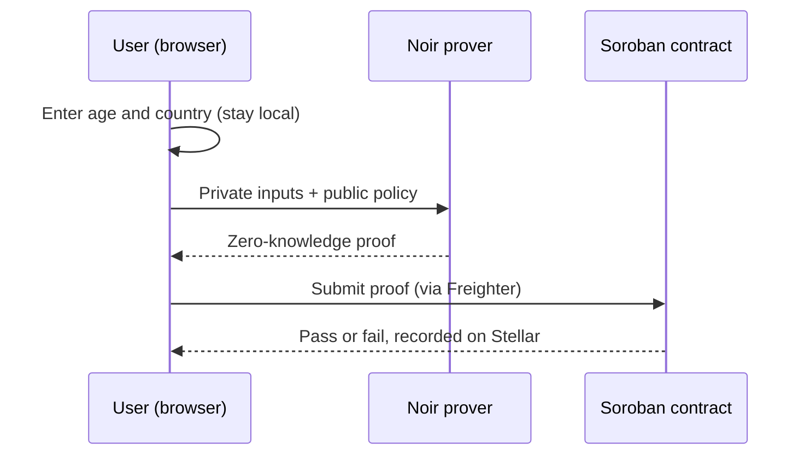

<div align="center">

# StellarProof

**Privacy-preserving KYC on Stellar, powered by zero-knowledge proofs.**

Prove you meet a policy (minimum age, allowed countries) without revealing your age or your country.

[](https://stellarproof-g4l6.vercel.app)
[](https://stellar.expert/explorer/testnet/contract/CAB232Q6K6WIHILWAAHW4K5DQQ4Q3ZRGOHSMRZSBTCXKDAHTOIVBDVCV)
[](https://nextjs.org)
[](https://developers.stellar.org/docs/build/smart-contracts)
[](https://noir-lang.org)

[Live demo](https://stellarproof-g4l6.vercel.app) | [Contract on Stellar Expert](https://stellar.expert/explorer/testnet/contract/CAB232Q6K6WIHILWAAHW4K5DQQ4Q3ZRGOHSMRZSBTCXKDAHTOIVBDVCV)

</div>

## Table of contents

- [The problem](#the-problem)
- [The solution](#the-solution)
- [How it works](#how-it-works)
- [Features](#features)
- [Project status](#project-status)
- [Tech stack](#tech-stack)
- [Getting started](#getting-started)
- [Project structure](#project-structure)
- [Roadmap](#roadmap)
- [Security and privacy notes](#security-and-privacy-notes)

## The problem

Traditional KYC asks users to hand over documents and personal data just to prove simple facts, such as "I am over 18" or "I live in an allowed country". That data is copied, stored, and leaked. The service rarely needs the data itself. It only needs the answer.

## The solution

StellarProof lets a verifier publish a policy and lets a user prove they satisfy it with a zero-knowledge proof. A Soroban smart contract on Stellar checks the proof on-chain. The result is public. The inputs never are.

## How it works



1. **Private inputs.** The user enters their age and country code. They never leave the browser.
2. **Proof.** A zero-knowledge proof shows the inputs satisfy the policy without revealing them.
3. **On-chain verification.** A Soroban contract verifies the proof. Only pass or fail is public.

## Features

| Area | What you get |
| --- | --- |
| Policy | Verifier sets the minimum age and picks allowed countries from selectable chips |
| Wallet | Freighter connect with a Testnet network check |
| Privacy | Inputs are never stored or transmitted; history keeps only time, result, and policy |
| Theme | Light and dark mode with no flash on load, remembers your choice |
| Languages | English, Kiswahili, Francais, Espanol, and Arabic with right-to-left layout |
| Responsive | Works from phone screens up to desktop |

## Project status

This is a hackathon prototype. Here is exactly what is real and what is not.

| Component | Status |
| --- | --- |
| Soroban verifier contract on Stellar Testnet | Deployed |
| Frontend (policy, wallet connect, i18n, theme, history) | Working |
| Wallet connection through Freighter | Working |
| Proof generation in the browser (Noir) | **Not yet wired.** The UI currently simulates the proof step and checks the policy locally |
| On-chain submission from the frontend (signed in Freighter, `verify_kyc` call) | Working |
| Contract verifies a ZK proof | **Not yet.** The deployed contract trusts a `proof_valid` flag sent by the caller and does not receive the age |

The transaction is real and recorded on Stellar Testnet, but the contract records the caller's claim and does not verify a zero-knowledge proof yet. The expiry countdown is a browser-side timer. See the [roadmap](#roadmap).

## Tech stack

- **Frontend:** Next.js, React, TypeScript, Tailwind CSS
- **Smart contract:** Rust, Soroban, Stellar Testnet
- **Zero-knowledge:** Noir circuits
- **Wallet:** Freighter (`@stellar/freighter-api`)

## Getting started

Requirements: Node.js 20 or newer.

```bash
git clone https://github.com/onchain-jojo/stellarproof.git
cd stellarproof
npm install
npm run dev
```

Open http://localhost:3000.

To install the [Freighter](https://www.freighter.app) wallet and use Testnet, switch the network inside the extension.

## Project structure

```text
app/
  components/   Header, Footer, WalletButton, ThemeToggle,
                LanguageSwitcher, HowItWorks, History
  config.ts     Contract ID and links
  countries.ts  Country list and default policy
  i18n.tsx      Translations and language provider
  layout.tsx    Root layout and theme bootstrap
  page.tsx      Main verification flow
```

## Roadmap

- [x] Frontend with configurable policy
- [x] Freighter wallet connect
- [x] Multi-language support with RTL
- [x] Light and dark theme
- [ ] Generate a real Noir proof in the browser
- [x] Submit a transaction to the Soroban contract and show the transaction hash
- [ ] Redeploy a contract that verifies the Noir proof on-chain
- [ ] Pass the policy as public inputs so the contract enforces it
- [ ] Credential expiry and revocation
- [ ] Translation review by native speakers
- [ ] Mainnet readiness and a circuit audit

## Security and privacy notes

- Testnet only. Do not enter real identity data.
- Zero-knowledge circuits need a professional audit before any production use.
- The attempt history is stored in your browser's local storage and contains no personal inputs.
- Translations are drafts and should be reviewed before public release.

## Contributing

Issues and pull requests are welcome.

## License

No license has been added yet. Add one (for example MIT) before accepting outside contributions.